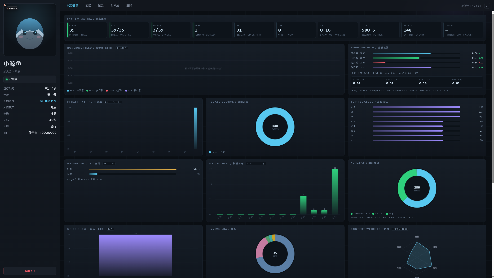
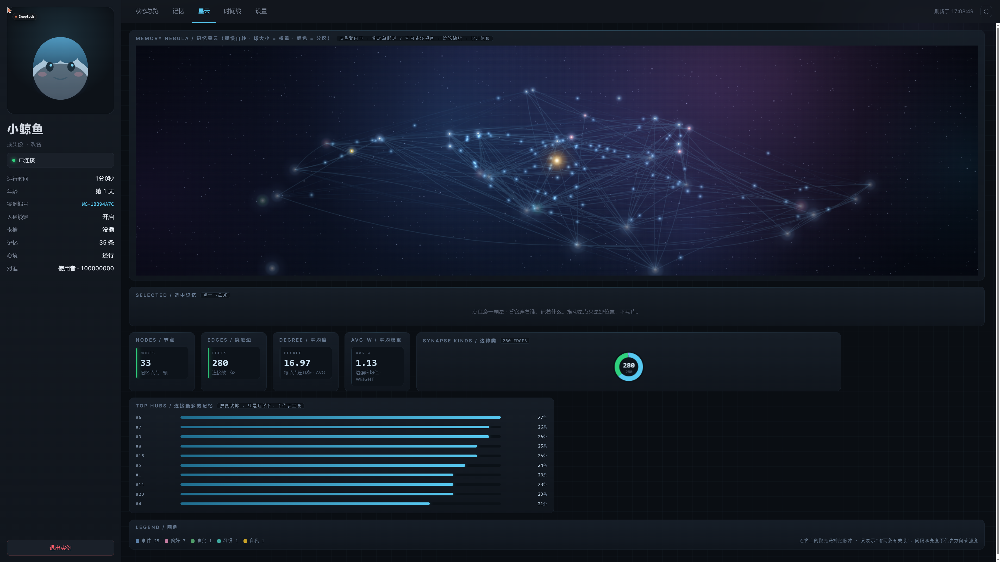

# 数字生命卡 · Life Card

> 给陪伴型 AI 的一张"会忘事的脑子"。
> 一个 SQLite 文件，拷到哪台机器上，她都还是她。

这不是一个聊天机器人框架，也不是又一个向量数据库封装。它只解决一件事：

**让一个长期陪在身边的人，记得住该记得的，忘得掉该忘的，并且不会假装记得。**





---

## 为什么需要它

大模型本身没有记忆。常见的替代方案有两种，都不太行：

| 做法 | 问题 |
| --- | --- |
| 把聊天记录往上下文里塞 | 塞满就爆；塞不满也分不清"昨天吃了什么"和"我是谁" |
| 全存进向量库，每次检索 | 什么都不忘 = 什么都没记住；三个月后她自己都分不清哪句是真心的 |

所以这张卡做了三件不太一样的事：

1. **分层**：短期存对话原文（会忘），中期是真正干活的主力，长期衰减很慢，最里面一层"底色"几乎不忘但会变。
2. **会忘**：权重按指数衰减，衰减到底不是直接删，而是分三段侵蚀——先忘掉"做了什么"（动词），再忘掉"对谁做的"（宾语），最后整条消失。这个过程是随机的、有概率的，像人，不像数据库。
3. **可验证**：每条记忆写入时都会开一张"出生证"（内容和时间做哈希，接进哈希链）。谁删了记忆，账本上必须留一笔；偷偷抽走一条，校验会当场报出来。

---

## 四个不变量

这些是设计里不许让步的部分，代码里写在注释和测试里：

1. **绝不假装记得。** 记不清就说记不清，然后去翻卡。翻不到就说翻不到。
2. **绝不为了留住谁而说假话。** 安慰不等于编造。
3. **绝不假装是别的谁。** 可以换名字、换头像，但不能冒充另一个人。
4. **遗忘是特性，不是 bug。** 一条记忆被侵蚀、被归档、被删除，都是有账可查的正常结局。

---

## 记忆模型

```
┌──────────────────────────────────────────────────────────────┐
│  core_fixed    骨头    自我认知，永不变、永不衰减             │
│  core_tag      标签    重要的人与关系，可改，不改就不动      │
│  core_mutable  底色    爱好 / 偏好 / 处境 / 价值观…会演化     │
│  mid           中期    真正的主力记忆：事件、事实、片段      │
│  long          长期    过了高门槛才进来，衰减很慢            │
│  short         短期    对话原文，快进快出                    │
└──────────────────────────────────────────────────────────────┘
```

几个关键数字（都在 `card2.py` 顶部，可以自己改）：

| 参数 | 值 | 含义 |
| --- | --- | --- |
| `LONG_NEED_RECALL` | 3 | 中期 → 长期：权重 ≥0.80 **且**被真正召回 3 次 |
| `LONG_PROTECT_DAYS` | 90 | 长期记忆被召回后 90 天内不衰减 |
| `CORE_MAX_ROWS` | 60 | 底色总条数上限（够用，不至于把卡塞满） |
| `HOBBY_ACTIVE_MAX` | 3 | 活跃爱好 3 个：人的精力就这么多 |
| `HOBBY_BUDGET` | 3.0 | 爱好总预算，新爱好进来要从最弱的里面抽 |
| `ERASE_W_FLOOR` | 0.02 | 权重掉到这以下才开始被侵蚀 |

底色不是"存进去就不动"，而是**演化式改写**：

```
"我讨厌香菜"
  → "我曾经讨厌香菜，现在能吃一点了"       （supersede，旧正文进 history）
  → "以前只能吃一点，现在能吃更多"          （再改写，保留上一代）
```

处境类记忆可以带 `valid_until`：比如"我在读高三"到期自动降级成普通记忆，不会永远挂在那儿。

---

## 快速开始

需要 Python 3.10+。

```bash
pip install numpy psutil

# 1) 生成一张假数据的示例卡（11 条记忆 + 人设 + 两条底色）
python tools/make_demo_card.py

# 2) 让服务用这张示例卡（不设就用本目录的 card.db，你的真卡）
#    Windows PowerShell:  $env:WHALE_DB="demo\demo_card.db"
#    cmd:                 set WHALE_DB=demo\demo_card.db
#    bash:                export WHALE_DB=demo/demo_card.db

# 3) 起"脑子"服务（第一次会加载向量模型，慢十几秒）
python bridge.py health

# 4) 打开控制台
#    http://127.0.0.1:8848/console
```

**向量模型是可选的。** 没有模型时也能跑，只是语义检索退化成字面匹配；
想要完整效果，把 `bge-small-zh-v1.5`（约 92 MB）放到 `models/` 下即可：

```bash
python dl_model.py            # 见文件头的下载说明，或自己去 HF/魔搭下
```

Windows 用户可以直接双击 `启动控制台.bat`（自动拉服务 + 开浏览器全屏）。

---

## 目录结构

```
whale-card/
├── card2.py            # 卡本体：记忆写入/召回/衰减/侵蚀/分层/演化（最大的一块）
├── timeline.py         # 时间线 + 出生证哈希链 + 删除台账
├── identity.py         # 身份锚：人设、名字、头像、封印校验
├── anchor.py           # 卡片外锚：卡离开这台机器也能验证身份没被改
├── synapse.py          # 突触网络：时间/标签/共现边 + 电势扩散联想
├── skill.py            # 程序性记忆 + 改良 SM2 复习曲线
├── hormone.py          # 四条激素（血清素/多巴胺/皮质醇/催产素）
├── ctxweight.py        # 六维上下文权重（身份/自我/印象/短时/描述/…）
├── semantic.py         # 语义层：向量检索 + 重排
├── embed_np.py         # 纯 numpy 的 bge 推理（不需要 torch）
├── mind_server.py      # HTTP 心智服务：/context /report /health /console …
├── console.py          # 网页控制台（状态总览 / 记忆 / 星云 / 时间线 / 设置）
├── bridge.py           # 命令行桥：卡没起服务就拉起来再问
├── snapshot.py         # 快照 / 加载 / 卸载 / 崩溃检测
├── cardslot.py         # "插卡/拔卡"：让宿主 AGENTS.md 和卡互斥
├── export_viz.py       # 星云图渲染
├── selfcheck.py        # 体检：链、出生证、锚、向量维度、备份…
├── tests/              # 22 组验收测试（都用临时卡，不碰真卡）
└── tools/              # 示例卡生成、模型下载、分层迁移
```

---

## 控制台

`http://127.0.0.1:8848/console` 五个页签：

- **状态总览**：状态矩阵、激素场 24H、实时 CPU/内存/磁盘（2 秒刷新）、召回频率、五池、权重分布、突触网络、存储、时间线吞吐、账本
- **记忆**：五层记忆比例、遗忘曲线（含 90 天保护期）、分区明细、写入流 14 天、高频记忆、召回来源、记忆账本、随手查询
- **星云**：把 574 条记忆画成一个缓慢自转的星系——星点大小=权重，颜色=分区，连线=突触，中心那颗金色的星是"我"；点一颗星会展开它的关联记忆
- **时间线**：24 小时吞吐 + 事件日志（boot / alive / talk / mem / erase …）
- **设置**：运行时账本

---

## 一些实现上的选择

- **单文件数据库**：`card.db` 里就是全部记忆。拷走=搬家，不需要导出导入。
- **纯 numpy 推理**：`embed_np.py` 自己读 safetensors / pytorch_model.bin，不依赖 torch。省下 2 GB 安装包和一个 CUDA 版本的坑。
- **WAL + busy_timeout**：控制台、桥、服务、快照会同时开同一个卡，读路径不许留写事务（这一条踩过坑：检索缓存忘 commit，会把别的进程锁死）。
- **维度由卡决定**：卡里存的是 768 维就自动用 768 维的模型，不靠环境变量猜；混维度时会明说"可用比例 X%"。
- **离线补账**：关机超过 24 小时，醒来会补一条"我睡了 X 天"的真记忆，而不是假装什么都没发生。

---

## 隐私

**这个仓库里没有作者的卡。** 没有聊天记录、没有真实姓名、没有 QQ 号、没有头像、没有截图、没有模型文件。
示例卡 `demo/demo_card.db` 里的 11 条记忆全是编的。

如果你要用它装自己的记忆：那张 `card.db` 就是你的隐私本身，别提交进版本库（`.gitignore` 已经挡了 `card.db*`）。

---

## 局限

- 语义层在没有模型时只能字面匹配。
- 星云在几千个节点时开始吃 GPU/CPU（有自适应降画质，但别指望上万条还顺滑）。
- 召回质量取决于你写记忆的粒度：一条一条写比整段丢进去好得多。
- 激素/心境是**给陪伴体验**服务的，不是科学模型。

---

## 许可证

MIT。拿去改、拿去用、拿去做产品都行，保留版权声明即可。

如果你也在做同样的事——给某个 AI 一张能忘事的脑子——欢迎来提 issue 说说你踩到的坑。
